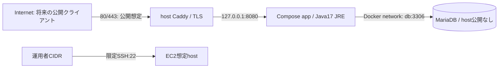
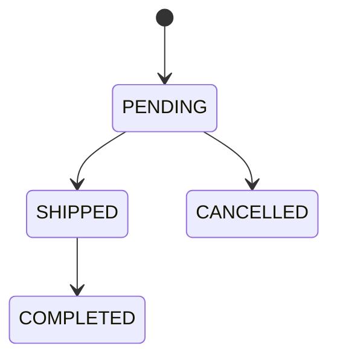

# Inventory Management System

在庫・注文の整合性を主題とする、Java / Spring BootのバックエンドREST APIです。
在庫の同時購入、注文の再送、途中失敗、価格変更があっても、注文・在庫・履歴を一貫して保存する設計を実装し、実MariaDBで検証しています。

**現行構成はAWS未配備として扱います。** 実AWSでの配備・公開TLS・本番運用の確認証跡はありません。
TerraformとCaddyは本番を想定した定義であり、Deploy workflowは`disabled_manually`です。
過去のAWS画像は現行構成の稼働証明ではありません。portfolio v1.0の正式完成判定は独立レビュー待ち、本番運用のGO判定とは分けます。

## まず見る資料

- [隔離Dockerデモ](docs/demo.md): 認証 → 商品 → 注文 → 在庫調整 → キャンセル → ADMIN確認を1コマンドで再現
- [現行の構成・監査証跡](docs/release-status.md): 対象SHA、CI、テスト数、既知のリスクと保証範囲
- [テスト手順](docs/testing.md) / [認証・JWT制約](docs/auth.md) / [APIエラー](docs/api-errors.md)
- [注文設計](docs/orders/order-aggregate.md) / [在庫設計](docs/inventory.md) / [配備手順](docs/deployment.md)

## 設計で重視したこと

| 課題 | 実装上の判断 | 回帰の根拠 |
|---|---|---|
| 同時注文による販売超過・更新消失 | 商品の悲観ロック、商品ID昇順取得、Transaction、version管理 | `InventoryConcurrencyMariaDbIT`。異なる実DB顧客20人、在庫10で成功10・不足10、履歴・金額も検証 |
| 通信再送による二重処理 | 注文・在庫調整のIdempotency-Keyを利用者単位で管理 | 同key/同内容は初回結果、別内容は409。`IdempotentOrderIT`ほか |
| 途中失敗と過去注文の書換え | 注文・在庫・履歴を一括commit/rollback。注文時の商品名・価格をsnapshot | 実MariaDBの失敗注入・rollback・スナップショット回帰 |
| 認証と権限の混同 | 署名/issuer/期限を検証し、現在のDBユーザー・roleで認可 | 実HTTPのUSER/ADMIN/所有者境界、JWT未署名・改ざん等の否定系 |
| 障害時の誤った成功判定 | 401/403/409/429と一時DB障害503・予期しない500を区別 | ProblemDetail、DB待機・切断、graceful shutdown、復旧後retryのIT |

[異なる顧客の競合条件と過去のロック除去対照実験](docs/orders/inventory-concurrency.md)を参照してください。
その対照実験の結果は当時のSHAに対する証拠であり、今のmainからロックを除去しているわけではありません。

## 技術構成

| 項目 | 現行mainの構成 |
|---|---|
| Java / Framework | Java 17、Spring Boot **4.1.1**、Spring Framework 7.0.9 |
| Security | Spring Security 7、JJWT 0.12.7、BCrypt、stateless JWT |
| Persistence | Spring Data JPA / Hibernate、MariaDB 12.2、Flyway V1〜V6 |
| Web / API docs | Spring MVC、Jakarta Validation、springdoc 3.1.1。Swaggerは明示したlocal profileのみ |
| Build / Tests | Maven Wrapper、JUnit、Surefire/Failsafe、Testcontainers |
| Container | digest固定Java17 JDK build + JRE runtime、Compose、UID/GID10001:10001 |
| Infra / CI | Terraform 1.15.6 / AWS provider 6.68.0、Caddy 2.11.7の定義、GitHub Actions必須5ジョブ |

バージョンの正本は[pom.xml](pom.xml)、Dockerfile、workflow、解決済みSBOMです。
通常ComposeのDBは`mariadb:12.2`の可変tag、検証fixtureは12.2.2のdigest固定であり、両者を同じ再現性とは扱いません。
H2はテスト補助で、本番用DBではありません。schemaはFlywayが管理し、Hibernateは`validate`、OSIVは無効です。

## 構成と信頼境界

以下は**本番想定の定義**です。今回のデモは使い捨てDockerのloopback HTTPを利用し、公的TLSは検証しません。



- appは`127.0.0.1:8080`だけにpublish。DBのhost3306、Caddy admin2019、app8080をpublicへ開く定義はありません。
- Caddyは転送ヘッダーを上書き/除去します。appのprod起動には実測した信頼proxy peerを`LOGIN_TRUSTED_PROXIES`へ設定する必要があります。Docker内部IPの決め打ちはしません。
- Caddyの実証は`CaddyProxyIT`の隔離network/local CAとmock hostまで。実DNS・EIP・公的証明書・実host peerは未確認です。
- runtimeは非root、read-only rootfs、capabilities削除、bounded tmpfs、明示メモリ制限です。[容量別予算](docs/docker-runtime.md)では、appとMariaDBを同居させる1 GiB hostを安全な本番構成とは推奨していません。

## APIと業務契約

| 利用者 | API | 主な契約 |
|---|---|---|
| 公開 | POST `/auth/register`、POST `/auth/login` | 登録はROLE_USER固定。独立した登録/ログイン制限、超過429/Retry-After、接続元判定不能503 |
| USER / ADMIN | GET `/products`、GET `/products/search?keyword=...`、GET `/products/{id}` | 一覧/検索のページング、keyword Unicode境界 |
| ADMIN | POST/PUT/DELETE `/products`系 | 商品名255コードポイントまで。PUTはversion必須、stockを変更しない |
| 本人 | POST/GET `/api/v1/me/orders`、GET `/{id}`、POST `/{id}/cancel` | 作成1〜100明細、Idempotency-Key必須、他者の注文は404 |
| ADMIN | `/api/v1/admin/orders`系 | 一覧・詳細・出荷・完了・CSV・売上・取消。詳細は設計文書 |
| ADMIN | `/api/v1/admin/products/{id}/inventory-adjustments`、`/inventory-movements` | 差分調整はkey必須、履歴を保存 |
| probe | `/livez`、`/readyz`（prod） | readinessはDBを含む。公開bodyはstatusのみ |

注文金額は円の整数long/BIGINT。商品名・単価は注文時にsnapshotし、overflowは変更前に拒否します。
旧`/orders/**`は廃止。Entityを直接返さずDTOを使います。



cancelはPENDINGだけで、在庫を一度だけ戻します。エラーは`application/problem+json`と`code`、server生成`X-Request-Id`で診断します。
詳細: [認可](docs/security/order-authorization.md)、[状態遷移](docs/orders/state-transitions.md)、[冪等性](docs/orders/idempotency.md)、[ページング](docs/orders/pagination.md)、[CSV](docs/order-csv.md)、[売上](docs/sales.md)。

## 手元で再現する

必要なのはJava17、Git、Docker daemon/Compose v2、Python3.12以上です。productionの資格情報は使いません。

```bash
./mvnw test       # unit/slice/H2補助。full verifyの代わりにはしない
./mvnw verify    # 実MariaDB/Testcontainersを含む全回帰
python3 scripts/docker/verify_image.py --scan --output target/portfolio-demo
```

Windowsは`./mvnw.cmd`と`python`へ読み替えます。JVMは`JAVA_HOME`でJava17を指定してください。
最後のコマンドはclean `git archive HEAD`からimageを作り、固有名のcontainer/network、新規tmpfs DB、random資格情報を使用します。
既存の`inventory-app`/`inventory-db`/volumeは使用しません。cleanupは所有labelを照合した自身の資源だけです。
手順・期待する在庫10→8→11→13・秘密値を含まない証跡は[デモ手順](docs/demo.md)へまとめています。
通常Composeは固定名と永続volumeを持つため、この隔離デモの代わりに安易に`docker compose up`しないでください。

Swagger UIはprodで無効です。local開発設定は[設定文書](docs/configuration.md)、ADMINの明示CLIは[provisioning手順](docs/initial-admin-provisioning.md)を参照してください。
公開API・通常起動・migrationからADMINを作る仕組みはありません。

## 検証結果とCI

基準はmain **`5f0fae4ebd89754e23538cb09f97a1ff037255ed`**、2026-10-18の
[main CI 39109302086](https://github.com/utl-flaxy/inventory-management-system/actions/runs/39109302086)です。
後続PRの新HEAD結果はPR本文・artifactで別に記録します。過去の件数を現在値として上書きしません。

| 検証 | mainで確認した結果 | 保証範囲 |
|---|---|---|
| Java17 full verify | **2,176件** = Surefire1,314 + Failsafe862、F/E/S=0 | MariaDB12.2.2 / JWT / 注文・在庫 / DB障害等。全負荷や将来の非フレーク性は未保証 |
| Python / Terraform | **29件 / mock27件**成功 | gate方針、Terraform構文・mock plan。実AWSへの適用ではない |
| Gitleaks / SpotBugs | 例外0・未解決0 / SECURITY違反0 | current tracked tree / main bytecode。履歴全体・全SASTではない |
| OSV / Trivy | Java169 components・advisory0 / **OS49件**（MEDIUM27/LOW22）、library0 | 別の監査対象。OSV0とimage脆弱性0を混同しない |
| Docker | clean build、非root、readiness、実API、shutdown、設定故障復帰PASS | 使い捨てlinux/amd64環境。公的TLS・実host性能・異版rollbackは未保証 |

必須ジョブは`test` / `terraform` / `secret-scan` / `java-static-analysis` / `dependency-audit`。
外部Actionは40桁SHA固定、権限はcontents:read、persist-credentials:false。mainはstrictな5チェック、管理者適用、linear history、force push/delete禁止を確認しています。
GitHubのrequired approving reviewsは0で、ChatGPTの独立レビューは人手の運用です。自動的に独立承認が強制されるとは説明しません。
OSV/Trivyはaudit-onlyであり、監査処理成功と脆弱性ゼロを区別します。

## 配備・復旧と既知の制約

- Deployは**無効**。main CI成功だけで現在配備される状態ではありません。将来の配備はCIの`DEPLOY_SHA`、revision label、app-onlyの`--no-deps --no-build`切替を維持する設計です。
- 現CI/デモのrollbackは**同一image IDの設定故障から直前設定へ復帰**する試験です。DB container再作成なし・業務データ不変を確認します。異なる旧バイナリと新schemaの互換性、実EC2での復旧を保証しません。
- app rollbackはDB rollbackではありません。migrationは自動undoせず、[backup/restore](docs/db/backup-restore.md)とschema互換性の判断が別途必要です。
- JWT個別失効/refresh、password変更・強制失効APIは未実装です。[JWTライフサイクル](docs/auth.md#jwtライフサイクルと失効制約)、[Issue #79](https://github.com/utl-flaxy/inventory-management-system/issues/79)を参照。username再割当てや旧鍵へ戻す操作の再受理リスクも残ります。
- Flyway/MariaDB12.2互換性WARN、Trivy OS由来49件を開示して継続監査します。負荷・容量・SLA・実secret・TLS・本番backup/restoreは未検証です。
- Terraformのremote state/lockingは[Issue #75](https://github.com/utl-flaxy/inventory-management-system/issues/75)。S3/RDS/Redisは将来拡張で、現行の完成判定へ含めません。

詳細: [Docker/メモリ](docs/docker-runtime.md)、[TLS](docs/tls.md)、[Terraform](terraform/README.md)、[配備/rollback](docs/deployment.md)、[監査状況](docs/release-status.md)。

## 履歴・開発資料

- [再構成前READMEの全文（固定main SHA）](https://github.com/utl-flaxy/inventory-management-system/blob/5f0fae4ebd89754e23538cb09f97a1ff037255ed/README.md)。旧図・スクリーンショット・当時の説明をこの履歴に保存します。
- [2026-10-02監査46件の当時の台帳](docs/audit/2026-10-02-remediation-traceability.md)、[依存66件の元台帳](docs/audit/2026-10-12-dependency-advisories.md)、[Issue76の当時の実測](docs/audits/issue-76-validation.json)。現在値は[release-status](docs/release-status.md)で区別します。
- [Epic #8](https://github.com/utl-flaxy/inventory-management-system/issues/8)、[Issue #123](https://github.com/utl-flaxy/inventory-management-system/issues/123)。Draft PR #103は統合検証用の履歴で、マージ対象・現行mainの品質証拠に含めません。
- [テスト一覧と手順](docs/testing.md)、[CI品質ゲート](docs/ci-quality-gates.md)、[Action更新方針](docs/github-actions-pinning.md)、[DB運用](docs/db/README.md)。

APIのOpenAPI版表示やPOMのSNAPSHOTは、製品v1.0のリリース承認を意味しません。
