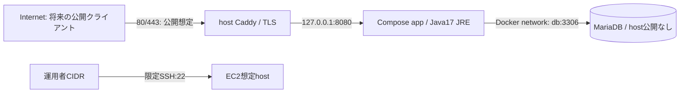
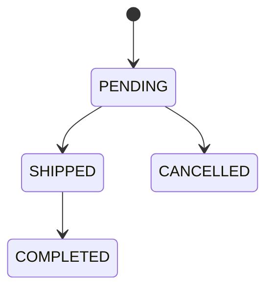

# Inventory Management System

在庫・注文の整合性を主題とする、Java / Spring BootのバックエンドREST APIです。
在庫の同時購入、注文の再送、途中失敗、価格変更があっても、注文・在庫・履歴を一貫して保存する設計を実装し、実MariaDBで検証しています。

顧客は商品を確認して注文・取消し、ADMINは商品・在庫・出荷/売上と利用者JWTの失効を管理します。
**Java17 / Spring Boot 4.1.1 / Spring Security 7 / MariaDB / JPA / Flyway / Docker**を使う、一つのアプリとDBで整合性を閉じる構成です。

## 90秒で見るバックエンドの強み

|難所|実装したこと・選択理由|ソースと常設テスト|
|---|---|---|
|20人が同じ在庫を購入する|DB行ロックとTransactionで販売超過を防ぐ。顧客ロックだけに依存せず、商品ID昇順で取得し在庫/注文/履歴を一括commit|[OrderService.createOrder](src/main/java/com/example/demo/service/OrderService.java) → [20顧客・在庫10の競合IT](src/test/java/com/example/demo/repository/InventoryConcurrencyMariaDbIT.java)。各試行で成功10/不足10、最終在庫0|
|注文POSTが再送される|顧客別Idempotency-Key＋本文指紋＋DB UNIQUE。業務更新と同じTxに保存し、二重注文/二重減算と失敗後のkey残留を防ぐ|[OrderService](src/main/java/com/example/demo/service/OrderService.java) / [指紋生成](src/main/java/com/example/demo/service/OrderRequestFingerprint.java) → [HTTP並行再送IT](src/test/java/com/example/demo/controller/IdempotentOrderIT.java)。同key同内容200、別内容409|
|JWTを発行後に失効させる|UUID主体＋DB世代照合。logout-all、本人password変更、再認証したADMINの強制失効を、世代更新/監査と同時commit|[logout](src/main/java/com/example/demo/service/AuthRevocationTransactions.java) / [password](src/main/java/com/example/demo/service/PasswordChangeTransactions.java) / [ADMIN](src/main/java/com/example/demo/service/AdminTokenRevocationTransactions.java) → [logout IT](src/test/java/com/example/demo/security/AuthRevocationIT.java) / [password IT](src/test/java/com/example/demo/security/AuthPasswordIT.java) / [ADMIN IT](src/test/java/com/example/demo/security/AdminTokenRevocationIT.java)。旧JWT401、権限不足403、他者注文404|

**確認済みmain snapshot（2026-10-23）:** Java **2,370件・F/E/S 0**、必須CI **5/5成功**。
[対象mainと実CI](https://github.com/utl-flaxy/inventory-management-system/actions/runs/39937244198)、[全検査の実測と範囲](docs/release-status.md)、[3シナリオの実行・source/test対応](docs/portfolio-walkthrough.md)へ進めます。
この日付固定の成功を将来のmainへ流用しません。[現在のmain CI](#現在のmain-ciを確認するlive)は別に確認します。

**応募版の提案はPORTFOLIO GO、今回の正式受入は独立レビュー待ち。本番運用はNO GO。**
10月18日の[独立受入GO](https://github.com/utl-flaxy/inventory-management-system/issues/130#issuecomment-6251677031)は当時の記録として保存し、拡張後の本提案と区別します。
個別jti失効/refreshは未実装です。TrivyはOS32件が残り、CI成功を「脆弱性ゼロ」「本番安全」と説明しません。

**現行構成はAWS未配備として扱います。** 実AWSでの配備・公開TLS・本番運用の確認証跡はありません。
TerraformとCaddyは本番を想定した定義であり、Deploy workflowは`disabled_manually`です。
過去のAWS画像は現行構成の稼働証明ではありません。portfolio v1.0の正式完成判定は独立レビュー待ち、本番運用のGO判定とは分けます。

## まず見る資料

- [隔離Dockerデモ](docs/demo.md): 認証 → 商品 → 注文 → 在庫調整 → キャンセル → ADMIN確認を1コマンドで再現
- [技術面接用の3シナリオ](docs/portfolio-walkthrough.md): 在庫競合・注文再送・JWT失効の理由→実装→テスト→保証限界
- [応募版の受入追補](docs/audit/portfolio-application-acceptance-2026-10-23.md): DoD16との対応、判定案と残存Issue
- [現行の構成・監査証跡](docs/release-status.md): 対象SHA、CI、テスト数、既知のリスクと保証範囲
- [テスト手順](docs/testing.md) / [認証・JWT制約](docs/auth.md) / [APIエラー](docs/api-errors.md)
- [注文設計](docs/orders/order-aggregate.md) / [在庫設計](docs/inventory.md) / [配備手順](docs/deployment.md)
- [Transaction・ロック設計](docs/design/transactions-and-locking.md) / [主要な設計判断と代替案](docs/design/decisions.md)

## 設計で重視したこと

<details>
<summary>5つの設計観点と実装・テストの詳細（上の3テーマとあわせて参照）</summary>

| 課題 | 実装上の判断 | 回帰の根拠 |
|---|---|---|
| 同時注文による販売超過・更新消失 | 商品の悲観ロック、商品ID昇順取得、Transaction、version管理。[OrderService](src/main/java/com/example/demo/service/OrderService.java) / [Product](src/main/java/com/example/demo/entity/Product.java) | [InventoryConcurrencyMariaDbIT](src/test/java/com/example/demo/repository/InventoryConcurrencyMariaDbIT.java)。異なる実DB顧客20人、在庫10で成功10・不足10、履歴・金額も検証 |
| 通信再送による二重処理 | 利用者単位のkey/指紋。[OrderService](src/main/java/com/example/demo/service/OrderService.java) / [InventoryService](src/main/java/com/example/demo/service/InventoryService.java) | 同key/同内容は初回結果、別内容は409。[IdempotentOrderIT](src/test/java/com/example/demo/controller/IdempotentOrderIT.java) / [在庫調整IT](src/test/java/com/example/demo/controller/InventoryAdjustmentIdempotencyIT.java) |
| 途中失敗と過去注文の書換え | 注文・在庫・履歴を一括commit/rollback、注文時snapshot。[OrderService](src/main/java/com/example/demo/service/OrderService.java) / [OrderItem](src/main/java/com/example/demo/entity/OrderItem.java) | [実MariaDBの途中失敗・snapshot回帰](src/test/java/com/example/demo/repository/InventoryConcurrencyMariaDbIT.java) / [金額境界IT](src/test/java/com/example/demo/controller/MoneyApiIT.java) |
| 認証と権限の混同 | 署名/issuer/期限を検証しDBの現在roleで認可。[JwtUtil](src/main/java/com/example/demo/security/JwtUtil.java) / [JwtAuthenticationFilter](src/main/java/com/example/demo/security/JwtAuthenticationFilter.java) | 実HTTPの[JWT否定系・USER/ADMIN境界](src/test/java/com/example/demo/security/JwtFilterRegistrationIT.java) / [所有者認可IT](src/test/java/com/example/demo/security/AuthorizationMatrixIT.java) |
| 障害時の誤った成功判定 | 401/403/409/429、一時DB障害503・予期しない500を区別。[ServerFailureResponse](src/main/java/com/example/demo/exception/ServerFailureResponse.java) / [prod設定](src/main/resources/application-prod.properties) | [DB切断と回復IT](src/test/java/com/example/demo/security/AuthDatabaseFailureIT.java) / [待機・rollback・再試行IT](src/test/java/com/example/demo/security/DatabaseTimeoutIT.java)。shutdownは[Docker検証](scripts/docker/verify_image.py) |

</details>

[異なる顧客の競合条件と過去のロック除去対照実験](docs/orders/inventory-concurrency.md)を参照してください。
その対照実験の結果は当時のSHAに対する証拠であり、今のmainからロックを除去しているわけではありません。

## 技術構成

| 項目 | 現行mainの構成 |
|---|---|
| Java / Framework | Java 17、Spring Boot **4.1.1**、Spring Framework 7.0.9 |
| Security | Spring Security 7、JJWT 0.12.7、BCrypt、Bearer JWT（HTTP sessionなし・DB世代照合） |
| Persistence | Spring Data JPA / Hibernate、MariaDB 12.2、Flyway V1〜V6＋Java V7（認証uid/失効世代/監査）＋V8（password変更監査）＋V9（ADMIN強制失効監査） |
| Web / API docs | Spring MVC、Jakarta Validation、springdoc 3.1.1。Swaggerは明示したlocal profileのみ |
| Build / Tests | Maven Wrapper、JUnit、Surefire/Failsafe、Testcontainers |
| Container | digest固定Java17 JDK build + JRE runtime、Compose、UID/GID10001:10001 |
| Infra / CI | Terraform 1.15.6 / AWS provider 6.68.0、Caddy 2.11.7の定義、GitHub Actions必須5ジョブ |

バージョンの正本は[pom.xml](pom.xml)、Dockerfile、workflow、解決済みSBOMです。
DBは通常Composeが`mariadb:12.2`、Java ITも主に`12.2.2`・一部`12.2`の可変tagです。
[Dockerデモ](scripts/docker/verify_image.py)だけは`12.2.2`の完全digestへ固定し、両者を同じbit再現性とは扱いません。
H2はテスト補助で、本番用DBではありません。schemaはFlywayが管理し、Hibernateは`validate`、OSIVは無効です。

## 構成と信頼境界

以下は**本番想定の定義**です。今回のデモは使い捨てDockerのloopback HTTPを利用し、公的TLSは検証しません。



- appは`127.0.0.1:8080`だけにpublish。DBのhost3306、Caddy admin2019、app8080をpublicへ開く定義はありません。
- Caddyは転送ヘッダーを上書き/除去します。appのprod起動には実測した信頼proxy peerを`LOGIN_TRUSTED_PROXIES`へ設定する必要があります。Docker内部IPの決め打ちはしません。
- Caddyの実証は`CaddyProxyIT`の隔離network/local CAとmock hostまで。実DNS・EIP・公的証明書・実host peerは未確認です。
- runtimeは非root、read-only rootfs、capabilities削除、bounded tmpfs、明示メモリ制限です。[容量別予算](docs/docker-runtime.md)では、appとMariaDBを同居させる1 GiB hostを安全な本番構成とは推奨していません。

## APIと業務契約

| 利用者 | API | 主な契約 |
|---|---|---|
| 公開 | POST `/auth/register`、POST `/auth/login` | 登録はROLE_USER固定。独立した登録/ログイン制限、超過429/Retry-After、接続元判定不能503 |
| 本人 | POST `/auth/logout-all` | 全端末失効をcommit後204、旧JWT/再送401。独立した認証管理制限、移行時は旧JWTを一括拒否 |
| 本人 | POST `/auth/password` | 現password検証後、新hash＋世代＋監査を一括commitし204。旧JWT全401、新passwordで再ログイン。logout-allと同時受付枠を共有 |
| ADMIN | POST `/api/v1/admin/users/{uid}/token-revocations` | 現ADMIN権限＋本人password再認証、対象全端末を失効し204。対象不在404は再認証後だけ。自己失効も可能 |
| USER / ADMIN | GET `/products`、GET `/products/search?keyword=...`、GET `/products/{id}` | 一覧/検索のページング、keyword Unicode境界 |
| ADMIN | POST/PUT/DELETE `/products`系 | 商品名255コードポイントまで。PUTはversion必須、stockを変更しない |
| 本人 | POST/GET `/api/v1/me/orders`、GET `/{id}`、POST `/{id}/cancel` | 作成1〜100明細、Idempotency-Key必須、他者の注文は404 |
| ADMIN | `/api/v1/admin/orders`系 | 一覧・詳細・出荷・完了・CSV・売上・取消。詳細は設計文書 |
| ADMIN | `/api/v1/admin/products/{id}/inventory-adjustments`、`/inventory-movements` | 差分調整はkey必須、履歴を保存 |
| probe | `/livez`、`/readyz`（prod） | readinessはDBを含む。公開bodyはstatusのみ |

注文金額は円の整数long/BIGINT。商品名・単価は注文時にsnapshotし、overflowは変更前に拒否します。
旧`/orders/**`は廃止。Entityを直接返さずDTOを使います。



cancelはPENDINGだけで、在庫を一度だけ戻します。エラーは`application/problem+json`と`code`、server生成`X-Request-Id`で診断します。
詳細: [認可](docs/security/order-authorization.md)、[状態遷移](docs/orders/state-transitions.md)、[冪等性](docs/orders/idempotency.md)、[ページング](docs/orders/pagination.md)、[CSV](docs/order-csv.md)、[売上](docs/sales.md)。

## 手元で再現する

必要なのはJava17、Git、Docker daemon/Compose v2、Python3.12以上です。productionの資格情報は使いません。

```bash
./mvnw test       # unit/slice/H2補助。full verifyの代わりにはしない
./mvnw verify    # 実MariaDB/Testcontainersを含む全回帰
python3 scripts/docker/verify_image.py --scan --output target/portfolio-demo
```

Windowsは`./mvnw.cmd`と`python`へ読み替えます。JVMは`JAVA_HOME`でJava17を指定してください。
最後のコマンドはclean `git archive HEAD`からimageを作り、固有名のcontainer/network、新規tmpfs DB、random資格情報を使用します。
既存の`inventory-app`/`inventory-db`/volumeは使用しません。cleanupは所有labelを照合した自身の資源だけです。
手順・期待する在庫10→8→11→13・秘密値を含まない証跡は[デモ手順](docs/demo.md)へまとめています。
[在庫競合・冪等性・JWT失効の対象ITコマンド](docs/portfolio-walkthrough.md)も掲載しています。有限の試験であり本番負荷測定ではありません。
通常Composeは固定名と永続volumeを持つため、この隔離デモの代わりに安易に`docker compose up`しないでください。

Swagger UIはprodで無効です。local開発設定は[設定文書](docs/configuration.md)、ADMINの明示CLIは[provisioning手順](docs/initial-admin-provisioning.md)を参照してください。
公開API・通常起動・migrationからADMINを作る仕組みはありません。

## 検証結果とCI

### 応募版の確認snapshot（2026-10-23）

main **`1632db72ebedfdc3cf316c442f199022e253133d`** / [main push CI39937244198](https://github.com/utl-flaxy/inventory-management-system/actions/runs/39937244198)のログ・artifactを取得して照合しました。

|検査|このSHA/runの実測|
|---|---|
|Java17 / Python|Surefire1,384＋Failsafe986＝**2,370、F/E/S 0/0/0** / **68件成功**|
|Terraform|host27＋bootstrap14＋synthetic8＝**49件成功**、mutation3件を期待したassertionで拒否。AWS無認証・backend=false|
|Secret / SpotBugs|例外0・未解決0（397 tracked files）/ SECURITY違反0（151 classes）。実正常/異常self-testも成功|
|OSV / Trivy|**169 components・advisory0** / **OS32（MEDIUM28/LOW4）、library0**。異なる監査対象で、audit-only|
|Docker / Flyway|非root/read-only JRE17、業務9段階＋B1/B2/B3、V1〜V9、shutdown、同image設定故障復帰。公的TLS/実host/異版rollbackは未検証|

必須5ジョブは全SUCCESS。PR HEADの実CIはPR本文の別runで確認します。
出典・DoD16・残余は[日付付き受入追補](docs/audit/portfolio-application-acceptance-2026-10-23.md)へ。以下の過去snapshotは数値を置き換えず保存します。

### 現在のmain CIを確認する（live）

[mainへのpushに絞ったSpring Boot CI](https://github.com/utl-flaxy/inventory-management-system/actions/workflows/ci.yml?query=branch%3Amain+event%3Apush)を開き、
先頭runの対象SHAが[main HEAD](https://github.com/utl-flaxy/inventory-management-system/commits/main/)と一致するか、必須5ジョブがすべてcompleted/successかを確認します。
新しいrunが未完了・失敗なら、下の過去の成功を現在の成功へ読み替えません。PRのCIはPR本文で別に確認します。

依存監査の[2026-10-21追補](docs/audit/2026-10-21-dependency-rebaseline-supplement.md)では、
旧Boot3.5のJava advisory66件と、main `7d10cca` のOSV169 components/0件・Trivy OS31件を区別しています。
Boot4のソース採用済みと本番導入・復旧・異版rollback未検証も別に判定します。以下の10月18日snapshotは当時の記録として保持します。

### 監査基準snapshot（2026-10-18 UTC確認）

<details>
<summary>10月18日の固定snapshot・以前のrun（現在値ではありません）</summary>

以下はmain **`0614d7d306fed5a3ec43ba7a7502b8bf7e65f3ed`**（PR #131 merge後）の
[main push CI 39136004541](https://github.com/utl-flaxy/inventory-management-system/actions/runs/39136004541)を取得して確認した固定記録です。
mainが進んだだけでこのSHA/runを置き換える必要はありません。現在の成否は上のlive入口で確認し、監査時点の値と区別します。
旧snapshotの[186aad8 / CI39123950859](https://github.com/utl-flaxy/inventory-management-system/actions/runs/39123950859)、
[f154801 / CI39127003622](https://github.com/utl-flaxy/inventory-management-system/actions/runs/39127003622)、
[5f0fae4 / CI39109302086](https://github.com/utl-flaxy/inventory-management-system/actions/runs/39109302086)も当時の証拠として保存します。
参照方針とD01/D12の是正根拠は[release-status](docs/release-status.md#d01d12の是正記録issue-132)へまとめています。

| 検証 | 監査snapshotで確認した結果 | 保証範囲 |
|---|---|---|
| Java17 full verify | **2,176件** = Surefire1,314 + Failsafe862、F/E/S=0 | MariaDB12.2.2 / JWT / 注文・在庫 / DB障害等。全負荷や将来の非フレーク性は未保証 |
| Python / Terraform | **29件 / mock27件**成功 | gate方針、Terraform構文・mock plan。実AWSへの適用ではない |
| Gitleaks / SpotBugs | 例外0・未解決0 / SECURITY違反0 | 当該SHAのtracked tree / main bytecode。履歴全体・全SASTではない |
| OSV / Trivy | Java169 components・advisory0 / **OS49件**（MEDIUM27/LOW22）、library0 | 別の監査対象。OSV0とimage脆弱性0を混同しない |
| Docker | clean build、非root、readiness、実API、shutdown、設定故障復帰PASS | 使い捨てlinux/amd64環境。公的TLS・実host性能・異版rollbackは未保証 |

</details>

必須ジョブは`test` / `terraform` / `secret-scan` / `java-static-analysis` / `dependency-audit`。
外部Actionは40桁SHA固定、権限はcontents:read、persist-credentials:false。mainはstrictな5チェック、管理者適用、linear history、force push/delete禁止を確認しています。
GitHubのrequired approving reviewsは0で、ChatGPTの独立レビューは人手の運用です。自動的に独立承認が強制されるとは説明しません。
OSV/Trivyはaudit-onlyであり、監査処理成功と脆弱性ゼロを区別します。

## 配備・復旧と既知の制約

- Deployは**無効**。main CI成功だけで現在配備される状態ではありません。将来の配備はCIの`DEPLOY_SHA`、revision label、app-onlyの`--no-deps --no-build`切替を維持する設計です。
- 現CI/デモのrollbackは**同一image IDの設定故障から直前設定へ復帰**する試験です。DB container再作成なし・業務データ不変を確認します。異なる旧バイナリと新schemaの互換性、実EC2での復旧を保証しません。
- app rollbackはDB rollbackではありません。migrationは自動undoせず、[backup/restore](docs/db/backup-restore.md)とschema互換性の判断が別途必要です。
- B1のUUID主体＋世代/logout-all、B2の本人password変更、B3のADMIN再認証付き強制失効は実装済みです。[JWTライフサイクル](docs/auth.md#jwtライフサイクルと失効制約)と[停止移行・rollback制約](docs/security/jwt-revocation-migration.md)を参照。[Issue #79](https://github.com/utl-flaxy/inventory-management-system/issues/79)はCLOSED、個別jti失効は[Issue #134](https://github.com/utl-flaxy/inventory-management-system/issues/134)で保留。refresh・password reset・role変更APIは未実装です。認証済みの進行中業務を強制rollbackする機能ではなく、旧binary・旧鍵・過去DBへの復帰には再受理リスクがあります。
- Flyway/MariaDB12.2互換性WARN、今回確認したTrivy OS32件を開示して継続監査します。負荷・容量・監視・SLA・実secret・TLS・本番backup/restore・異版rollbackは未検証です。
- Windows DatabaseTimeoutITの初回観測CLI3失敗は根因未確定です。単独再実行やLinux CI成功で失敗を抹消せず、[監査記録](docs/audit/portfolio-v1-final-acceptance-2026-10-18.md#ローカル補助検証)を保持します。
  証明書時刻・Wait strategy・Caddy初回失敗も[Issue #145](https://github.com/utl-flaxy/inventory-management-system/issues/145)で追跡し、今回の成功で解消としません。
- Terraformのremote state/lockingは[Issue #75](https://github.com/utl-flaxy/inventory-management-system/issues/75)。S3/RDS/Redisは将来拡張で、現行の完成判定へ含めません。
  [remote state ADR](docs/design/terraform-remote-state.md)に従うS3部分設定と[独立bootstrap root](terraform-bootstrap/README.md)を静的実装しています。実AWSでのbackend作成・移行・IAM/排他/復旧は未検証です。[移行・復旧手順](docs/operations/terraform-remote-state.md)は別承認が必要で、Issue #75はOPENです。
  [AWS無接続のsynthetic検証と拒否ゲート](terraform-sandbox-tests/README.md)を追加しています。B01〜B14は未承認、実TF-CはBLOCKEDで、CI成功はAWS実行許可を意味しません。

詳細: [Docker/メモリ](docs/docker-runtime.md)、[TLS](docs/tls.md)、[Terraform](terraform/README.md)、[配備/rollback](docs/deployment.md)、[監査状況](docs/release-status.md)。

## 履歴・開発資料

- [再構成前READMEの全文（固定main SHA）](https://github.com/utl-flaxy/inventory-management-system/blob/5f0fae4ebd89754e23538cb09f97a1ff037255ed/README.md)。旧図・スクリーンショット・当時の説明をこの履歴に保存します。
- [2026-10-02監査46件の当時の台帳](docs/audit/2026-10-02-remediation-traceability.md)、[依存66件の元台帳](docs/audit/2026-10-12-dependency-advisories.md)、[Issue76の当時の実測](docs/audits/issue-76-validation.json)。現在値は[release-status](docs/release-status.md)で区別します。
- [Epic #8](https://github.com/utl-flaxy/inventory-management-system/issues/8)、[Issue #123](https://github.com/utl-flaxy/inventory-management-system/issues/123)。Draft PR #103は統合検証用の履歴で、マージ対象・現行mainの品質証拠に含めません。
- [テスト一覧と手順](docs/testing.md)、[CI品質ゲート](docs/ci-quality-gates.md)、[Action更新方針](docs/github-actions-pinning.md)、[DB運用](docs/db/README.md)。

APIのOpenAPI版表示やPOMのSNAPSHOTは、製品v1.0のリリース承認を意味しません。
