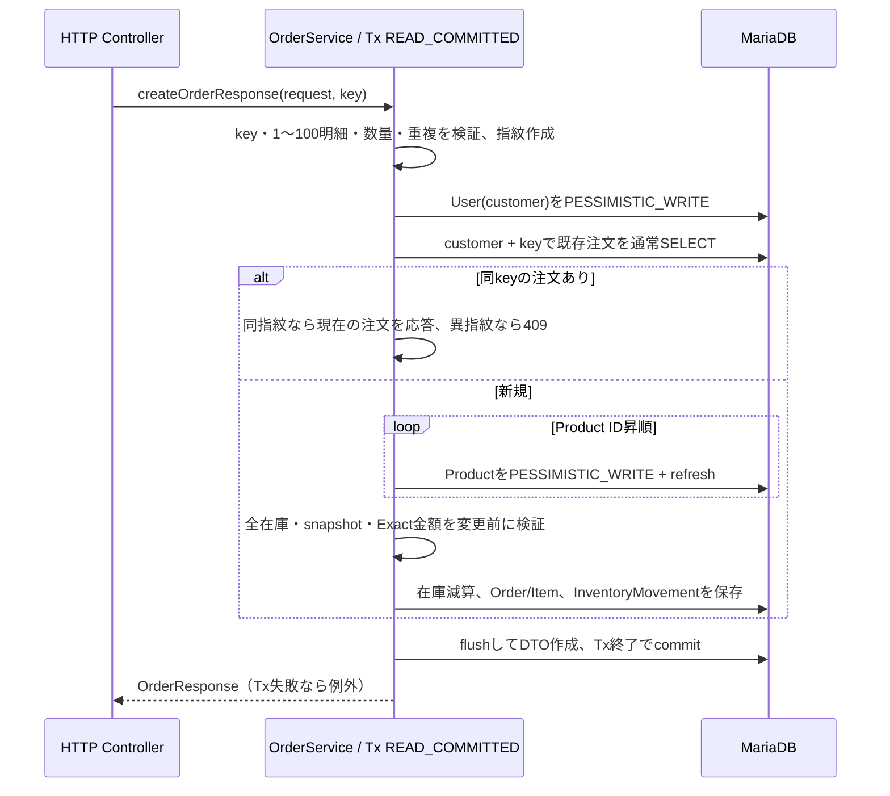

# トランザクション境界と競合制御

Issue #128で、main `186aad8cb41fa7d7227304aeed4a4c3d6436ad69`の実装を照合した設計説明。
本書は新しいロック方式や分離レベルを導入するものではない。
[設計判断](decisions.md)、[冪等性](../orders/idempotency.md)、[在庫台帳](../inventory.md)も参照する。

## 1. Transactionを開始・終了する場所

**B1追加（Issue #136）:** 認証readは[JwtUserAuthenticator](../../src/main/java/com/example/demo/security/JwtUserAuthenticator.java)の
READ_COMMITTED / readOnly / REQUIRES_NEWとJDBC projectionで、業務のREPEATABLE_READ/Entity cacheから分離する。
loginはBCryptをTx外で1回行い、[LoginTokenIssuer](../../src/main/java/com/example/demo/service/LoginTokenIssuer.java)の短いREAD_COMMITTED Txで
Userだけをロック/refreshして事前のuid/hash/username/世代を再確認する。
[logout-all](../../src/main/java/com/example/demo/service/AuthRevocationTransactions.java)もUserだけをロックし、世代増分と監査を同じTxでcommitする。
Order/Productのロックを追加取得せず、下記の業務ロック順を変えない。
commit後の新しい認証readが失効境界であり、先に認証済みの注文が完遂する場合がある。
根拠: [実MariaDB/HTTPのcommit・競合試験](../../src/test/java/com/example/demo/security/AuthRevocationIT.java)。
業務の409と認証Userロックの503は区別し、既存の待機予算は維持する。

HTTPの注文操作はControllerからSpring管理の
[OrderService](../../src/main/java/com/example/demo/service/OrderService.java)へ入り、
`createOrderResponse` / `cancelMyOrderResponse` / `shipOrderResponse`等のpublicメソッドの
`@Transactional`を境界にする。通常の伝播はREQUIREDで、新しい独立Transactionを操作ごとに増やさない。
同じbean内で呼ぶ`createOrder`等のannotationはself-invocationで再評価されないため、
外側のDTO入口にも対応するTransaction属性を明記している。

書込み応答は`writeResponse`がflushしてからDTOを組み立てる。これによりversion/更新日時を応答へ写すが、
**flushはcommitではない**。commit/rollbackと行ロック解放はTransactionの終了時である。
例外でcommitできなければ正常DTOはHTTPへ返らない。
共通設定の[OSIV=false](../../src/main/resources/application.properties)により、JSON出力の遅延SELECTに依存しない。

| 処理 | 実装の境界・分離レベル | 意図と限界 |
|---|---|---|
| 注文作成、本人取消、ADMIN状態コマンド | OrderServiceのDTO入口と直接業務入口、READ_COMMITTED | 在庫・注文・明細・履歴を同じ書込みTxで扱う |
| ADMIN手動在庫調整 | [InventoryService.adjust](../../src/main/java/com/example/demo/service/InventoryService.java)、READ_COMMITTED | 在庫・履歴・調整の冪等性メタデータを一括commit |
| 注文に伴う履歴 | 同Serviceの`recordOrderChange`、MANDATORY | 呼出元のTx必須。REQUIRES_NEWや履歴だけの独立commitは行わない |
| 商品名/価格PUT、削除 | [ProductService.update/delete](../../src/main/java/com/example/demo/service/ProductService.java)、READ_COMMITTED | 更新はversion、削除は商品ロックと参照確認/FK |
| 注文ページ一覧 | OrderServiceの`findMyOrders/findAll`、readOnly + REPEATABLE_READ | IDページ取得と関連projection取得を同じsnapshot内で行う |
| CSV export | OrderServiceの`exportCsv`、readOnly + REPEATABLE_READ、rollbackFor=IOException | 500行ずつのprojectionを同期送信。送信中も接続/Txを保持する |
| 商品参照、注文詳細、在庫履歴、期間付き売上集計 | 各ServiceのreadOnly、Isolation.DEFAULT | annotationで分離レベルを上書きしない。全環境の実DB既定値を断定しない |
| Auth登録・商品POST | [AuthService.register](../../src/main/java/com/example/demo/service/AuthService.java) / ProductService.saveからRepositoryの書込みTx | Serviceに外側Txなし。単一saveAndFlush/saveのcommit/rollbackをRepositoryに委ねる |

`readOnly`は書込み禁止権限や全SQLの実行時間制限ではない。
属性の回帰は[ServiceTransactionBoundaryTest](../../src/test/java/com/example/demo/service/ServiceTransactionBoundaryTest.java)、
3 profileでの実HTTPセッション境界は[OsivApiIT](../../src/test/java/com/example/demo/controller/OsivApiIT.java)で確認する。
Auth登録は失敗したRepository Txの外で対象UNIQUE違反を409へ変換し、rollback-only Tx内で再照会しない。

## 2. 行ロックの順序

以下は**明示的に要求する業務ロック**の順序である。認証や参照の通常SELECT、FK検査等のDB内部ロックまで
すべて列挙したSQL実行順ではない。Userは顧客または操作ADMINの実DB行を意味する。

| 操作 | 先に取るロック → 後で取るロック | 補足 |
|---|---|---|
| 注文作成 | User(customer) → Product(ID昇順) | customer/keyの既存注文は通常queryで確認し、既存OrderへFOR UPDATEしない |
| 本人取消 | 所有者条件付きOrder → User(actor) → Product(ID昇順) | 他人の注文は404。注文を取得してから別queryで所有者を照合しない |
| ADMIN取消 | Order → User(actor) → Product(ID昇順) | actorは操作ADMIN。注文顧客と同一とは限らない |
| 出荷・完了 | Order | 状態遷移を直列化。出荷/完了で在庫を復元しない |
| ADMIN手動調整 | User(actor) → 対象Product | actor/key判定をProduct取得前に行う |
| 商品PUT | 通常読取り → version付きUPDATE | 明示的な悲観ロックなし。クライアントversionとJPA @Versionで競合を検出 |
| 商品削除 | Product | 注文明細/履歴の参照確認、DB FKを最終防御にする |

ロックqueryは[UserRepository](../../src/main/java/com/example/demo/repository/UserRepository.java)、
[ProductRepository](../../src/main/java/com/example/demo/repository/ProductRepository.java)、
[OrderRepository](../../src/main/java/com/example/demo/repository/OrderRepository.java)の`PESSIMISTIC_WRITE`。
OrderServiceは商品/注文をロック下で`refresh`し、先にPersistence Contextへ入った古いstock/価格/状態で判断しない。
入力明細はTreeMapでID昇順、取消もdistinct/sort後に商品をrefreshする。

同じ顧客の注文作成や同じactorの調整をUser行で直列化する代償として、同じ利用者の独立した商品操作も待つ。
別顧客のUser行は別々だが、同一商品のProduct行では競合する。
取消はOrderを先に取る。User→Productという説明だけで全コマンドを同一順とみなしてはならない。
取消でactorのFK挿入用ロックをProduct取得後まで遅らせず、手動調整との待機サイクルを避ける設計である。
この順序は対象経路のデッドロックリスクを下げるが、未知のSQL・外部更新・全スケジュールでの不発生証明ではない。

## 3. 注文作成と再送の流れ

Idempotency-Keyは[OrderRequestFingerprint](../../src/main/java/com/example/demo/service/OrderRequestFingerprint.java)で
productId/quantityを正規化した指紋と結び付ける。順序やJSON空白が変わっても同じ意味ならreplayし、
同keyで異なる意味なら409。keyは顧客単位であり全利用者共通のロック/識別子ではない。
価格・stockは指紋へ含めず、replayで現在価格を再計算したり、再減算したりしない。
注文の現在の状態を返すので、応答バイト列を永久保存する方式とも異なる。

最終防御は[V4の(customer_id, idempotency_key) UNIQUE](../../src/main/resources/db/migration/V4__add_order_idempotency.sql)。
手動調整は[V6の(actor_user_id, idempotency_key) UNIQUE](../../src/main/resources/db/migration/V6__add_inventory_adjustment_idempotency.sql)と
[InventoryAdjustmentFingerprint](../../src/main/java/com/example/demo/service/InventoryAdjustmentFingerprint.java)を使う。
対象の重複制約違反だけを409へ変換し、失敗Txの中で再検索して成功へ見せない。
失敗してrollbackした処理はkeyを消費しない。ネットワーク切断時はcommit済みか不明になり得るため、
クライアントは同じkey・同じ本文で再送する。任意の外部副作用までexactly-onceになるという保証ではない。

## 4. 楽観ロック・snapshot・DB制約の役割

[Product](../../src/main/java/com/example/demo/entity/Product.java)と[Order](../../src/main/java/com/example/demo/entity/Order.java)は
`@Version`を持つ。商品PUTはリクエストversionを現在値と比較した上でsaveAndFlushし、
注文と同時に読んだ古い商品更新がstock/価格を黙って上書きしないよう、JPAのversion競合も検出する。
在庫の高競合経路は悲観ロックで読取り〜検証〜更新を守る。version単体を在庫ロックの代わりとは説明しない。

[OrderItem](../../src/main/java/com/example/demo/entity/OrderItem.java)は商品名・単価を注文時にコピーする。
商品マスター更新後も過去注文の値を使い、円のlong/BIGINTでmultiplyExact/addExactする。
作成は全商品の不足・金額overflowを先に検証し、取消も全明細の復元後stockをaddExactで検証してから変更する。

[V1](../../src/main/resources/db/migration/V1__baseline_schema.sql)のCHECK/UNIQUE/FK、
[V2](../../src/main/resources/db/migration/V2__widen_money_columns_to_bigint.sql)のBIGINT、
[V5](../../src/main/resources/db/migration/V5__create_inventory_movements.sql)の履歴整合制約はDBの最終防御。
ただし「注文合計=全明細合計」「すべてのstock更新に必ず履歴がある」までDB制約だけで強制しているわけではない。
業務Serviceの同一Tx・ドメイン検証・回帰テストも必要であり、DBを直接変更する権限の濫用は対象外。

## 5. rollback・障害分類・待機予算

在庫不足、不正遷移、overflow、保存時のRuntimeException等ではService Tx全体をrollbackする。
途中でflush済みでも、注文・明細・在庫・履歴の一部だけをcommitしない。
同一注文へのcancel競合はOrderロックと状態検証で、復元を一度だけにする。
履歴書込み失敗を無視して注文だけ成功にせず、MANDATORY参加のまま失敗させる。

| 層 | prodの設定値 | 何を制限するか |
|---|---|---|
| HikariCP | pool10、connection-timeout5000ms、validation1000ms | 接続数・接続取得/検証待ち |
| MariaDB session | innodb_lock_wait_timeout=5秒 | 対象InnoDB行ロック待機 |
| Spring Tx | default-timeout=10秒 | Tx/queryの期限。あらゆるJava処理/HTTP送信を10秒で中断する保証ではない |
| JDBC driver | connectTimeout3000ms、socketTimeout30000ms | 接続・DBソケットの待機 |
| shutdown | Boot phase30秒、Compose stop_grace_period35秒 | 新規受付停止と進行処理のdrain、終了猶予 |

正本は[prod properties](../../src/main/resources/application-prod.properties)と[Compose](../../docker-compose.yml)。
各待機は段階や時計が違い、単純加算をHTTP SLAとはしない。row-lock競合409と、DB一時障害503、
予期しない/設定障害500は[ServerFailureResponse](../../src/main/java/com/example/demo/exception/ServerFailureResponse.java)・
[APIエラー](../api-errors.md)の契約で区別し、すべてのDB例外を503へ変換しない。

CSVはread-only Tx内でwriter.flushするため、遅いクライアントによる接続保持の課題が残る。
HTTPへ一部を送信済みならエラー本文へ差し替えられない。[CSV仕様](../order-csv.md)の制約を参照する。
shutdownの成功例も実本番の負荷・復旧時間保証ではない。

**アプリTxのrollbackとDB DDLのrollbackは別である。** Flyway V1〜V6は改変せず、
MariaDBのDDL/importをアプリTxと同じように全体undoできるとは仮定しない。
[DB移行](../db/README.md)・[backup/restore](../db/backup-restore.md)とschema互換性判断が必要。
Dockerの現行復帰試験は同一image IDの故障設定復帰であり、旧binary/schema/旧鍵の互換rollbackを証明しない。

## 6. 検証できていることとテストへの入口

| 論点 | テストと確認点 |
|---|---|
| 別顧客の販売超過/更新消失 | [InventoryConcurrencyMariaDbIT](../../src/test/java/com/example/demo/repository/InventoryConcurrencyMariaDbIT.java) の `twentyDistinctCustomersCompeteForTenUnitsWithoutOverselling`。20実DB顧客、在庫10、10成功/10不足、20接続、注文/明細/台帳/version/金額、3反復 |
| 複数商品の逆順入力、古い読取り | 同ITの `reverseInputMultiProductOrdersCommitWithoutDeadlockAndCancelExactlyOnce`、`cancellationRefreshesProductLoadedBeforeConcurrentOrder`、`orderRefreshDoesNotImplicitlyLockProductsBeforeExplicitInventoryLocking` |
| cancel/ship/complete、商品version | 同ITの `cancelAndShipCannotBothSucceed`、`twentyConcurrentCompletionsRecognizeRevenueAndTimestampOnlyOnce`、`optimisticVersionRejectsUpdateThatReadBeforeOrderCommitted` |
| 作成のreplay/conflict/rollback | [IdempotentOrderIT](../../src/test/java/com/example/demo/controller/IdempotentOrderIT.java) の `twentyConcurrentSameRequestsAllReturnOneOrderAndReduceStockOnce`、`failureDoesNotConsumeKeyAndRetryAfterRestockCreatesExactlyOneOrder`、`specificUniqueViolationIs409AndRollsBackAttemptedStockChangesWithoutReplaying` |
| 手動調整のrollback/ロック順 | [InventoryAdjustmentIdempotencyIT](../../src/test/java/com/example/demo/controller/InventoryAdjustmentIdempotencyIT.java) の `failureAfterActualMovementInsertRollsBackStockMovementAndKey`、`cancellationWaitsForActorBeforeProductSoManualTransactionCanFinishWithoutLockCycle` |
| 金額・DB不変 | [MoneyApiIT](../../src/test/java/com/example/demo/controller/MoneyApiIT.java) の乗算/合計overflow、同競合ITのmulti-product shortage/overflow、snapshot保持 |
| DB障害/待機・同key retry | [DatabaseTimeoutIT](../../src/test/java/com/example/demo/security/DatabaseTimeoutIT.java)、[AuthDatabaseFailureIT](../../src/test/java/com/example/demo/security/AuthDatabaseFailureIT.java)。rollback、DB不変、ロック解放、pool残留0、回復後再試行 |
| shutdownと設定故障復帰 | [verify_image.py](../../scripts/docker/verify_image.py) / [デモ証跡](../demo.md)。受付停止、進行処理、接続/lock waits0、再起動後replay |

H2の[OrderCancellationTransactionTest](../../src/test/java/com/example/demo/repository/OrderCancellationTransactionTest.java)は
保存失敗・複数行rollbackの補助であり、MariaDB行ロックの根拠と混同しない。
商品ロック除去による失敗対照は[PR #109当時の隔離実験](../orders/inventory-concurrency.md)の証拠。
今回のbranchや共有mainでロックを削除したわけではない。

WindowsのDatabaseTimeoutITは、Issue #126の初回full verifyで観測CLI exit1による3失敗があり、
単独再実行9件は成功した。**初回根因は未確定**であり、証明書や単なるフレークと断定しない。
旧HTTP6500ms観測超過と同一原因とも扱わない。[監査§10](../audit/portfolio-v1-final-acceptance-2026-10-18.md#10-本監査自身の検証とレビュー手順)の失敗記録を保持する。
本PRのfull verify/CI結果はPR本文に別記し、skip・pool/timeout緩和で上書きしない。

これらは有限のfixtureでの実証であり、分散構成・長時間負荷・全デッドロック・本番SLAの保証ではない。
